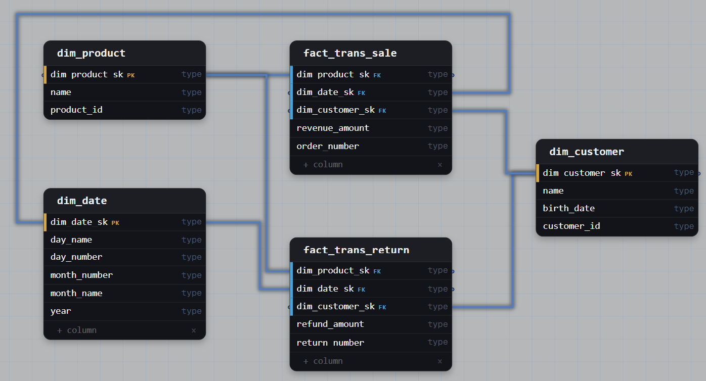

# Task 1: Marketplace Orders and Returns (Conformed Dimensions)

## Task

> An online marketplace runs two reporting stacks: the sales team measures completed orders and the returns team measures refunded items, and the two teams report different customer counts for the same month. Model a warehouse where order revenue and return refunds report against a single, shared definition of a customer and of a product, so that one query can compare what a customer bought against what they sent back. Keep orders and returns as separate fact tables at their own grains.

## Business Context

- Each team kept its own customer list, so the same month produced different customer counts.
- Orders and returns are different processes with different grains, dates and measures. A return happens later than the order and may cover only part of it.
- The goal is one shared meaning of customer, product and date, while each process keeps its own fact table.

## Schema



## Query Patterns

**One process.** Revenue per month uses only the sales fact.

```sql
SELECT d.year, d.month_number, SUM(f.revenue_amount) AS revenue
FROM fact_trans_sale f
JOIN dim_date d ON f.dim_date_sk = d.dim_date_sk
GROUP BY d.year, d.month_number;
```

**Both processes (drill-across).** Each fact is aggregated to customer × month separately, then the results are joined.

```sql
WITH sales AS (
  SELECT f.dim_customer_sk, d.year, d.month_number,
         SUM(f.revenue_amount) AS revenue
  FROM fact_trans_sale f
  JOIN dim_date d ON f.dim_date_sk = d.dim_date_sk
  GROUP BY 1, 2, 3
),
returns AS (
  SELECT f.dim_customer_sk, d.year, d.month_number,
         SUM(f.refund_amount) AS refunds
  FROM fact_trans_return f
  JOIN dim_date d ON f.dim_date_sk = d.dim_date_sk
  GROUP BY 1, 2, 3
)
SELECT c.customer_id, k.year, k.month_number,
       COALESCE(s.revenue, 0) AS revenue,
       COALESCE(r.refunds, 0) AS refunds
FROM (SELECT dim_customer_sk, year, month_number FROM sales
      UNION
      SELECT dim_customer_sk, year, month_number FROM returns) k
JOIN dim_customer c ON c.dim_customer_sk = k.dim_customer_sk
LEFT JOIN sales s   USING (dim_customer_sk, year, month_number)
LEFT JOIN returns r USING (dim_customer_sk, year, month_number);
```

**Customer count.** Both teams use `COUNT(DISTINCT customer_id)` on the same `dim_customer`.

## Solution

| Decision | Why |
|---|---|
| **Conformed `dim_customer`, `dim_product`, `dim_date`** | One definition and one surrogate key in both facts, so counts match and purchases can be compared with returns. |
| **Two facts, not one** | Different grains, dates and measures. A single table would need nullable columns and make `SUM` and `COUNT` ambiguous. |
| **Both are transaction facts** | An order line and a returned item are one-time events, not periodic summaries. |
| **Grain** | Sale: one row per order line. Return: one row per returned item. |
| **Own event date per fact** | Order date for sales, return date for returns. A refund appears in the month it was issued. |
| **Degenerate `order_number`, `return_number`** | Document identifiers with no descriptive attributes. They stay in the fact. |
| **Business key in each dimension** | Allows the same entity to be recognized across source systems. |

## Key Points

- Dimensions are shared, facts differ by process and grain.
- Facts are never joined directly: the join multiplies rows (fan-out) and inflates measures. Drill-across avoids it.
- Definitions such as "active customer" belong in fact or metrics logic, not in the dimension.
