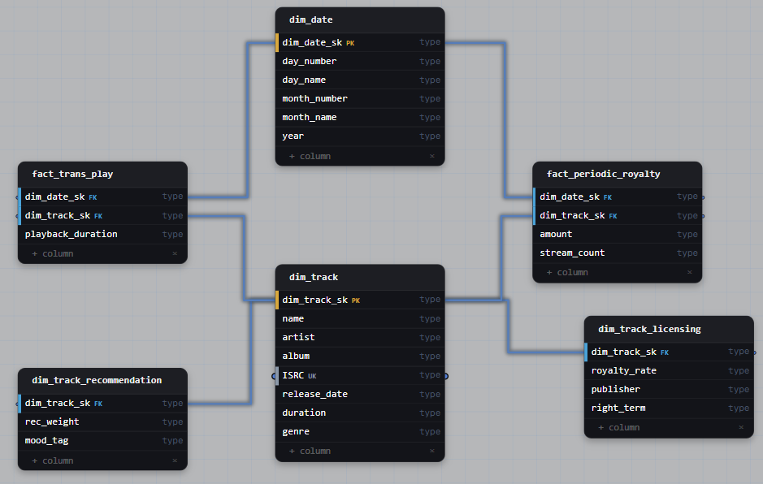

# Task 2: Music Streaming Plays and Royalties 

## Task

> An analyst reconciling a music-streaming platform's numbers finds the product team's plays fact and the licensing team's royalties fact both slicing by track and calendar date, each against its own definition. Design conformed track and date dimensions that both facts share, where a track's shared identity is its name, artist, album, ISRC, release date, duration and genre. Product also keeps recommendation weights and mood tags per track, and licensing keeps royalty rates, publisher and rights terms per track.

## Business Context

- Product and licensing each defined "track" and "date" on their own, so the same numbers do not reconcile.
- Both teams need the same core track identity, but each also owns attributes the other does not use.
- Putting every team's attributes into one track dimension would couple the teams: a change on one side affects everyone who reads the table.
- The goal is one shared track and date definition, with team-specific attributes kept out of the shared core.

## Schema



## Query Patterns

**Shared core.** Both facts group by the same track attributes and the same calendar.

```sql
SELECT t.genre, d.year, d.month_number, COUNT(*) AS plays
FROM fact_trans_play f
JOIN dim_track t ON f.dim_track_sk = t.dim_track_sk
JOIN dim_date d  ON f.dim_date_sk = d.dim_date_sk
GROUP BY t.genre, d.year, d.month_number;
```

**Both facts (drill-across).** Each fact is aggregated to track × month separately, then the results are joined.

```sql
WITH plays AS (
  SELECT f.dim_track_sk, d.year, d.month_number,
         COUNT(*) AS plays,
         SUM(f.playback_duration) AS playback_duration
  FROM fact_trans_play f
  JOIN dim_date d ON f.dim_date_sk = d.dim_date_sk
  GROUP BY 1, 2, 3
),
royalties AS (
  SELECT f.dim_track_sk, d.year, d.month_number,
         SUM(f.amount) AS royalty_amount,
         SUM(f.stream_count) AS stream_count
  FROM fact_trans_royalty f
  JOIN dim_date d ON f.dim_date_sk = d.dim_date_sk
  GROUP BY 1, 2, 3
)
SELECT t.ISRC, t.name, t.artist, k.year, k.month_number,
       p.plays, r.royalty_amount
FROM (SELECT dim_track_sk, year, month_number FROM plays
      UNION
      SELECT dim_track_sk, year, month_number FROM royalties) k
JOIN dim_track t ON t.dim_track_sk = k.dim_track_sk
LEFT JOIN plays p     USING (dim_track_sk, year, month_number)
LEFT JOIN royalties r USING (dim_track_sk, year, month_number);
```

**Team-specific attributes.** The extension is joined only by the team that needs it.

```sql
SELECT l.publisher, SUM(f.amount) AS royalty_amount
FROM fact_trans_royalty f
JOIN dim_track_license l ON f.dim_track_sk = l.dim_track_sk
GROUP BY l.publisher;
```

## Solution

| Decision | Why |
|---|---|
| **Conformed `dim_track` and `dim_date`** | One definition and one surrogate key in both facts, so plays and royalties reconcile by track and day. |
| **Conformed core = shared identity only** | Name, artist, album, ISRC, release date, duration, genre are used by every consumer. |
| **Team-specific attributes in extensions** | `dim_track_product` (recommendation weight, mood tag) and `dim_track_license` (royalty rate, publisher, rights term) keep teams decoupled. |
| **Extensions keyed by `dim_track_sk`** | One row per track (1:1). Joined only when needed, so the core stays small. |
| **ISRC as business key** | Identifies the same recording across source systems. |
| **Grain** | Play: one row per play. Royalty: one row per royalty entry. |
| **Two transaction facts** | Different processes, grains and measures. Joined only through drill-across, because a direct join multiplies rows (fan-out). |

## Watch Out

- A track with several rights terms or frequently changing rates does not fit a single 1:1 row. It needs history (SCD) or a bridge table.
