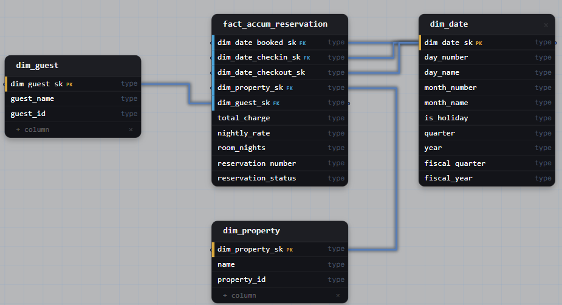

# Task 3: Vacation Rental Reservations 

## Task

> A vacation-rental booking platform needs a warehouse model for its reservations. Every reservation records when it was booked, when the guest checks in, and when they check out, along with the property, the guest, the nightly rate, and the total charge. Analysts have to report revenue by booking month, room-nights by check-in month, and departures by checkout month, all sliced by the same calendar attributes such as weekday, holiday flag, and fiscal quarter. Design the dimensional model that serves all three time-based views without duplicating the calendar logic.

## Business Context

- A reservation carries three dates, and each report needs a different one: booking date for revenue, check-in date for room-nights, checkout date for departures.
- All three views must use the same calendar attributes. Copies of the calendar would let weekday, holiday and fiscal definitions drift apart.
- A reservation moves through stages (booked, checked in, checked out) and may be cancelled, so one row per reservation is updated over time.
- The goal is one calendar definition, referenced three times.

## Schema



## Query Patterns

**Same fact, different role.** Only the FK in the join changes.

```sql
-- Revenue by booking month
SELECT d.year, d.month_number, SUM(f.total_charge) AS revenue
FROM fact_accum_reservation f
JOIN dim_date d ON f.dim_date_booked_sk = d.dim_date_sk
WHERE f.reservation_status <> 'cancelled'
GROUP BY d.year, d.month_number;

-- Room-nights by check-in month
SELECT d.year, d.month_number, SUM(f.room_nights) AS room_nights
FROM fact_accum_reservation f
JOIN dim_date d ON f.dim_date_checkin_sk = d.dim_date_sk
WHERE f.reservation_status <> 'cancelled'
GROUP BY d.year, d.month_number;

-- Departures by checkout month
SELECT d.year, d.month_number, COUNT(*) AS departures
FROM fact_accum_reservation f
JOIN dim_date d ON f.dim_date_checkout_sk = d.dim_date_sk
WHERE f.reservation_status = 'checked_out'
GROUP BY d.year, d.month_number;
```

**Several roles in one query.** Aliases make each role explicit.

```sql
SELECT booked.day_name AS booked_on,
       checkin.is_holiday AS holiday_checkin,
       SUM(f.total_charge) AS revenue
FROM fact_accum_reservation f
JOIN dim_date booked  ON f.dim_date_booked_sk  = booked.dim_date_sk
JOIN dim_date checkin ON f.dim_date_checkin_sk = checkin.dim_date_sk
GROUP BY booked.day_name, checkin.is_holiday;
```

## Solution

| Decision | Why |
|---|---|
| **One physical `dim_date`, three FKs** | Booked, check-in and checkout are roles of the same calendar. Weekday, holiday flag and fiscal quarter are defined once. |
| **No copies of `dim_date`** | Separate tables would duplicate calendar logic and allow definitions to diverge. |
| **Views per role (optional)** | `dim_booked_date`, `dim_checkin_date`, `dim_checkout_date` as plain `SELECT *` views make roles visible to BI tools. Aliases work for small teams. |
| **Fiscal columns in `dim_date`** | Fiscal quarter and year come from one place, whichever role is used. |
| **Accumulating snapshot fact** | A reservation passes through milestones and may be modified or cancelled. One row per reservation is updated in place. |
| **Grain** | One row per reservation. |
| **"Not yet occurred" key** | A milestone that has not happened yet points to a special row in `dim_date`, not to NULL. Such rows are excluded from date-based reports. |
| **`reservation_status`** | Shows the current stage and separates cancelled reservations from the rest. |
| **Measures** | `total_charge` and `room_nights` are additive. `nightly_rate` is not: averages are computed as `SUM(total_charge) / SUM(room_nights)`. |
| **Business keys** | `guest_id` and `property_id` identify the same guest and property across source systems. |
| **Degenerate `reservation_number`** | Document identifier with no descriptive attributes. It stays in the fact. |

## Watch Out

- A stay that spans two months is counted entirely in the check-in month. Accurate room-nights per calendar month need a separate fact at one row per reservation night.
- Cancelled reservations must be excluded or reported separately, otherwise revenue and room-nights are overstated.
- Without views or aliases, a report can silently use the wrong date role.
