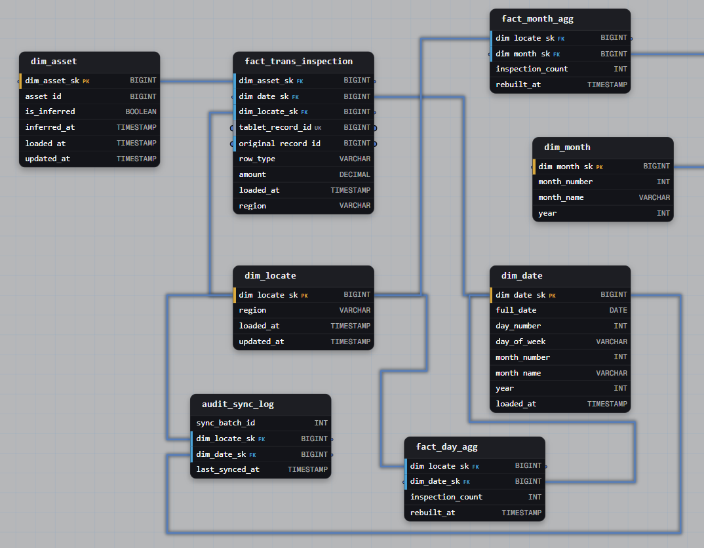

# Task 1: Utility Inspections from Offline Tablets

## Task

> Utility crews record inspections on offline tablets in areas without signal and sync them days later. Interrupted syncs resend the same records. The analyst who owns the per-region daily and monthly counts published on the operations dashboard needs each inspection to count on its actual date, deduplicated by tablet record ID, with region directly on every fact row. If the asset is not registered yet, a placeholder asset marked as inferred is created so the fact loads without waiting. Corrections and voids arrive as new rows with a delta value linked to the original. The sync log captures (region, inspection_date) pairs with a composite key. The aggregates are keyed on (region, inspection_date) and (region, inspection_month) with a rebuild timestamp, and rebuilds overwrite only stale periods so the pipeline is fully replayable from scratch.

## Business Context

- Inspections reach the warehouse days after they happen. They must be counted on the inspection date, not the sync date.
- A resent sync delivers records that were already loaded. Counting them twice inflates the dashboard.
- An inspection can reference an asset that is not registered yet. Waiting for the asset would block the load.
- Source corrections and voids arrive after reports have been published. History must stay intact.
- Dashboard numbers for a past period change only when data for that period actually arrived.

## Schema



## Query Patterns

**Daily count per region from the base fact.** Voids and corrections are rows with a delta, so `SUM` is the only aggregation needed.

```sql
SELECT f.region, d.year, d.month_number, d.day_number,
       SUM(f.amount) AS inspections
FROM fact_trans_inspection f
JOIN dim_date d ON f.dim_date_sk = d.dim_date_sk
GROUP BY f.region, d.year, d.month_number, d.day_number;
```

**Idempotent fact load.** Inferred members are created first, then only unseen records are inserted.

```sql
-- 1. Placeholder for assets that are not registered yet
INSERT INTO dim_asset (asset_id, is_inferred, inferred_at, loaded_at)
SELECT DISTINCT s.asset_id, TRUE, CURRENT_TIMESTAMP, CURRENT_TIMESTAMP
FROM staging_inspection s
LEFT JOIN dim_asset a ON a.asset_id = s.asset_id
WHERE a.asset_id IS NULL;

-- 2. Load only records that are not in the fact yet
INSERT INTO fact_trans_inspection
  (dim_asset_sk, dim_date_sk, dim_locate_sk, region,
   tablet_record_id, original_record_id, row_type, amount, loaded_at)
SELECT a.dim_asset_sk, d.dim_date_sk, l.dim_locate_sk, l.region,
       s.tablet_record_id, s.original_record_id, s.row_type, s.amount,
       CURRENT_TIMESTAMP
FROM staging_inspection s
JOIN dim_asset  a ON a.asset_id  = s.asset_id
JOIN dim_date   d ON d.full_date = s.inspection_date
JOIN dim_locate l ON l.region    = s.region
WHERE NOT EXISTS (
  SELECT 1 FROM fact_trans_inspection f
  WHERE f.tablet_record_id = s.tablet_record_id
);
```

**Backfill of an inferred asset.** The surrogate key stays the same, so no fact row is touched.

```sql
UPDATE dim_asset a
SET is_inferred = FALSE,
    updated_at  = CURRENT_TIMESTAMP
FROM asset_feed r
WHERE a.asset_id = r.asset_id
  AND a.is_inferred = TRUE;
```

**Void of an inspection.** A new row with a negative delta that points to the original.

| tablet_record_id | original_record_id | row_type | amount |
|---|---|---|---|
| R1 | NULL | original | +1 |
| R2 | R1 | void | −1 |

`SUM(amount)` for this inspection is 0, and both rows stay in the table.

**Stale daily periods.** A period is stale if data arrived after its last rebuild, or if it was never built.

```sql
SELECT s.dim_locate_sk, s.dim_date_sk
FROM audit_sync_log s
LEFT JOIN day_agg a
  ON a.dim_locate_sk = s.dim_locate_sk
 AND a.dim_date_sk   = s.dim_date_sk
WHERE a.rebuilt_at IS NULL
   OR s.last_synced_at > a.rebuilt_at;
```

**Rebuild of stale days only.** Delete and insert in one transaction, so the result is the same however many times it runs.

```sql
CREATE TEMP TABLE stale_day AS
SELECT s.dim_locate_sk, s.dim_date_sk
FROM audit_sync_log s
LEFT JOIN day_agg a
  ON a.dim_locate_sk = s.dim_locate_sk
 AND a.dim_date_sk   = s.dim_date_sk
WHERE a.rebuilt_at IS NULL OR s.last_synced_at > a.rebuilt_at;

BEGIN;
  DELETE FROM day_agg d
  USING stale_day s
  WHERE d.dim_locate_sk = s.dim_locate_sk
    AND d.dim_date_sk   = s.dim_date_sk;

  INSERT INTO day_agg (dim_locate_sk, dim_date_sk, inspection_count, rebuilt_at)
  SELECT f.dim_locate_sk, f.dim_date_sk, SUM(f.amount), CURRENT_TIMESTAMP
  FROM fact_trans_inspection f
  JOIN stale_day s
    ON s.dim_locate_sk = f.dim_locate_sk
   AND s.dim_date_sk   = f.dim_date_sk
  GROUP BY f.dim_locate_sk, f.dim_date_sk;
COMMIT;
```

**Stale months.** A month is stale if any of its days received data after the month was last rebuilt.

```sql
SELECT DISTINCT s.dim_locate_sk, m.dim_month_sk
FROM audit_sync_log s
JOIN dim_date  d ON d.dim_date_sk = s.dim_date_sk
JOIN dim_month m ON m.year = d.year AND m.month_number = d.month_number
LEFT JOIN month_agg a
  ON a.dim_locate_sk = s.dim_locate_sk
 AND a.dim_month_sk  = m.dim_month_sk
WHERE a.rebuilt_at IS NULL
   OR s.last_synced_at > a.rebuilt_at;
```

## Solution

| Decision | Why |
|---|---|
| **Transaction fact, append-only** | An inspection is a one-time event. Rows are never updated, so corrections and voids are new rows. |
| **Grain** | One row per tablet record. Original, void and correction are separate records with their own identifiers. |
| **Own event date, separate `loaded_at`** | `dim_date_sk` holds the inspection date and drives all counts. `loaded_at` records when the pipeline saw the row. Event time and processing time are never mixed. |
| **`region` column in the fact** | The requirement is region on every fact row. It is frozen at inspection time and lets aggregates be built from the fact without a join. Region is taken from the inspection record, never from the asset, because an inferred asset has no known region. |
| **`dim_locate_sk` kept as well** | Links the fact to the shared location dimension. Both values come from the same source row so they cannot disagree. |
| **`tablet_record_id` unique** | The dedup key. A resent record has the same ID, so it is recognized and skipped. This makes the load idempotent. |
| **`original_record_id` as self-referencing FK** | A correction or void points to the row it changes. The reference is enforced by the database. It is NULL for original rows. |
| **`row_type` and `amount` as delta** | `row_type` separates original, void and correction. `amount` is +1 for an inspection and −1 for a void, so a plain `SUM` is always correct and no `CASE` is needed. |
| **Reversal rows, no UPDATE** | The audit trail stays intact and already published numbers can be explained. |
| **Inferred member in `dim_asset`** | `is_inferred` and `inferred_at` mark the placeholder. The fact loads at once with a valid key. The key does not change at backfill, so no fact row is rewritten. |
| **`asset_id` as natural key, unique** | The real asset record finds its placeholder through it. Without uniqueness two placeholders could appear for one asset. |
| **`audit_sync_log` as control table** | Grain: one row per region per inspection date, with a composite key. `last_synced_at` records when data for the period last arrived and `sync_batch_id` which sync delivered it. It is pipeline metadata and sits outside the star. |
| **`day_agg` and `month_agg` as aggregate tables** | Derived facts at a higher grain, keyed on (region, date) and (region, month). The dashboard reads from them. |
| **`dim_month`** | Month is its own entity, so the month aggregate does not point to a single day in `dim_date`. |
| **`rebuilt_at` in each aggregate** | A period is stale when `last_synced_at` is later than `rebuilt_at`. Only stale periods are rebuilt. |
| **Delete-insert in a transaction** | A rebuild gives the same result however many times it runs. Together with the append-only fact this makes the pipeline replayable from scratch. |

## Watch Out

- A correction that moves an inspection to another region or date needs a void at the old place and a new row at the right place. Otherwise the old period keeps a wrong count.
- `region` and `dim_locate_sk` in the fact must come from the same source value.
- A void or correction can arrive before its original. The self-referencing key requires the original to exist, so such rows must wait or be loaded after it.
- `sync_batch_id` in a log keyed on (region, date) shows only the latest batch for the period. Keeping every batch would change the key.
- Month aggregates depend on days. Stale days are rebuilt first, then the months that contain them.
- Records older than the late-data SLA go to reconciliation instead of silently changing published history.
- Inferred assets older than a set threshold signal a degrading upstream feed and should be monitored.
